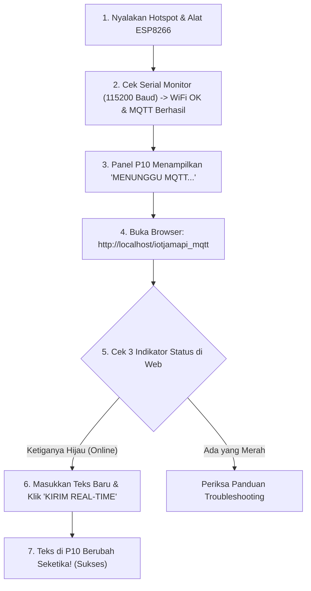

# 📘 PANDUAN PRAKTIKUM SISWA: KONFIGURASI MANDIRI IOT P10 MQTT

Dokumen ini adalah panduan langkah demi langkah bagi setiap siswa untuk mengonfigurasi dan mengoperasikan **Web Dashboard** serta **Alat IoT Panel P10** masing-masing.

---

## 💡 Konsep Utama: Mengapa Harus Diedit?

Sistem ini menggunakan **Broker MQTT Publik** (`broker.emqx.io`) yang terbuka di internet.
* Jika semua siswa memakai nama saluran (*Topic*) bawaan yang sama (`sekolah/iot/p10/data`), maka saat **Siswa A** mengirim teks dari web miliknya, panel P10 milik **Siswa B, C, dan seluruh kelas akan ikut berubah**.
* Agar setiap siswa memiliki jalur komunikasi pribadi antara Web dan Alatnya sendiri, **setiap siswa wajib membuat Topik MQTT yang unik**.

---

## 🏷️ Format Identitas Unik Siswa
Sebelum mulai mengedit, tentukan **Kode Unik** masing-masing. Gunakan format:
```text
<kelas>/<absen>_<nama>
```
* **Contoh:**
  * Kelas: `rpl1`
  * No. Absen: `05`
  * Nama: `budi`
  * **Kode Topik Data:** `sekolah/rpl1/05_budi/data`
  * **Kode Topik Status:** `sekolah/rpl1/05_budi/status`

---

## 🧰 Persiapan & Kebutuhan Software

Sebelum memulai, pastikan software berikut telah terpasang di komputer/laptop:
1. **XAMPP** (Modul Apache & MySQL aktif).
2. **Web Browser** (Google Chrome / Mozilla Firefox / Microsoft Edge).
3. **Text Editor** (Visual Studio Code, Sublime Text, atau Notepad++).
4. **Arduino IDE** dengan library yang sudah di-install:
   - `PubSubClient` (oleh Nick O'Leary)
   - `DMDESP` (untuk mengontrol panel P10)
   - `ArduinoJson` (oleh Benoit Blanchon)

---

## 🗄️ LANGKAH 1: Setup Database MySQL Siswa

Setiap siswa menjalankan database lokal di laptop masing-masing agar data teks dan setelan tersimpan di komputer sendiri.

### 1.1 Import Database di phpMyAdmin
1. Buka **XAMPP Control Panel**, klik tombol **Start** pada **Apache** dan **MySQL**.
2. Buka browser, akses URL: `http://localhost/phpmyadmin`.
3. Klik menu **Import** di bar navigasi atas.
4. Klik **Choose File / Browse**, lalu pilih file `db_iot.sql` yang ada di folder project ini.
5. Gulir ke bawah dan klik tombol **Import** (atau **Kirim**).
6. Database `db_iot` dan tabel `setting_p10` akan terbentuk otomatis dengan 1 baris data default.

### 1.2 Pengecekan File `koneksi.php`
Buka file `koneksi.php`. Pastikan konfigurasinya sesuai:
```php
// Baris 9 - 12
$host = "localhost";  // Tetap 'localhost' jika menggunakan XAMPP lokal
$user = "root";       // Username default XAMPP
$pass = "";           // Password default XAMPP adalah kosong
$db   = "db_iot";     // Nama database yang diimpor tadi
```
> [!NOTE]
> Jika siswa menggunakan XAMPP standar tanpa mengganti password database, file `koneksi.php` **tidak perlu diubah**.

---

## 🌐 LANGKAH 2: Konfigurasi Web Dashboard (`index.html`)

Buka file `index.html` dengan text editor (misal VS Code), kemudian lakukan perubahan pada bagian berikut:

### 2.1 Menyesuaikan Judul Dashboard (Baris 25)
Ubah judul halaman agar menampilkan nama siswa:
```html
<!-- SEBELUM: -->
<h3 class="text-center mb-4">🚀 Panel P10 Real-Time (MQTT)</h3>

<!-- SESUDAH (Contoh untuk Budi Absen 05): -->
<h3 class="text-center mb-4">🚀 Panel P10 - Budi (Absen 05)</h3>
```

### 2.2 Mengubah Konfigurasi Topik MQTT (Baris 89 - 93) ⚠️ WAJIB DIUBAH!
Cari blok script konfigurasi MQTT pada baris 89–93:
```javascript
// SEBELUM:
const mqtt_broker = "broker.emqx.io";
const mqtt_port = 8084;
const mqtt_topic = "sekolah/iot/p10/data";
const mqtt_topic_status = "sekolah/iot/p10/status";
const client_id = "web_guru_" + Math.random().toString(16).substr(2, 8);

// SESUDAH (Ganti dengan kode unik masing-masing siswa):
const mqtt_broker = "broker.emqx.io";
const mqtt_port = 8084;
const mqtt_topic = "sekolah/rpl1/05_budi/data";          // Saluran kirim pesan
const mqtt_topic_status = "sekolah/rpl1/05_budi/status";  // Saluran cek status alat
const client_id = "web_05budi_" + Math.random().toString(16).substr(2, 8);
```

**Penjelasan Baris Kode:**
* `mqtt_broker`: Server perantara pengiriman data secara real-time.
* `mqtt_port`: Port 8084 digunakan untuk protokol aman WebSockets (WSS).
* `mqtt_topic`: Alamat frekuensi tempat web mengirimkan data JSON ke alat P10.
* `mqtt_topic_status`: Alamat tempat web mendengarkan status alat (apakah nyala/mati).
* `client_id`: ID acak pengenal browser agar koneksi tidak bentrok dengan siswa lain.

Simpan file `index.html` (`Ctrl + S`).

---

## 🤖 LANGKAH 3: Konfigurasi Firmware Alat IoT (`p10_mqtt/p10_mqtt.ino`)

Buka file `p10_mqtt/p10_mqtt.ino` menggunakan **Arduino IDE**.

### 3.1 Mengatur Koneksi WiFi / Hotspot (Baris 17 - 18)
Mikrokontroler ESP8266 membutuhkan koneksi internet untuk dapat bertukar pesan dengan broker MQTT.
```cpp
// SEBELUM:
const char* ssid = "olrait";
const char* password = "12345678";

// SESUDAH (Sesuaikan dengan nama Hotspot HP / WiFi siswa):
const char* ssid = "Hotspot_Budi";
const char* password = "katasandibudi";
```
> [!IMPORTANT]
> Modul ESP8266 hanya mendukung jaringan WiFi frekuensi **2.4 GHz**. Jika menggunakan Personal Hotspot dari smartphone, pastikan opsi **"Maximize Compatibility"** atau **pita 2.4 GHz** sudah diaktifkan.

### 3.2 Menyamakan Topik MQTT dengan Web (Baris 24 & Baris 119) ⚠️ WAJIB SAMA PERSIS!
Topik pada program Arduino **HARUS SAMA PERSIS** (case-sensitive / huruf besar-kecil diperhatikan) dengan yang ditulis di `index.html`.

* **1. Topik Data (Baris 24):**
```cpp
// SEBELUM:
const char* mqtt_topic = "sekolah/iot/p10/data";

// SESUDAH:
const char* mqtt_topic = "sekolah/rpl1/05_budi/data"; // Wajib sama dengan index.html
```

* **2. Topik Status & LWT (Baris 119):**
Cari fungsi `konekMQTT()` di baris 119:
```cpp
// SEBELUM:
const char* topic_status = "sekolah/iot/p10/status";

// SESUDAH:
const char* topic_status = "sekolah/rpl1/05_budi/status"; // Wajib sama dengan index.html
```

### 3.3 Penyesuaian Ukuran Panel P10 (Baris 30 - 31)
Jika siswa menggunakan 1 panel standar ukuran 32x16 pixel:
```cpp
#define DISPLAYS_WIDE 1 // Jumlah panel ke samping (lebar)
#define DISPLAYS_HIGH 1 // Jumlah panel ke bawah (tinggi)
```
*(Biarkan nilai tetap 1 jika hanya memakai satu unit panel P10).*

### 3.4 Upload Program ke ESP8266 / NodeMCU
1. Hubungkan modul ESP8266 ke Laptop dengan kabel data micro USB.
2. Buka menu **Tools > Board > ESP8266 Boards**, lalu pilih **NodeMCU 1.0 (ESP-12E Module)**.
3. Buka menu **Tools > Port**, pilih port COM yang terdeteksi (misal `COM3`, `COM4`, dst).
4. Klik tombol **Upload** (ikon panah kanan `➔`).
5. Tunggu hingga proses kompilasi dan upload selesai hingga muncul tulisan `Leaving... Hard resetting via RTS pin...`.

---

## 📊 TABEL RINGKASAN PERUBAHAN (CHEAT SHEET)

| No | File | Baris | Nilai Asli / Contoh | Nilai Setelah Diedit Siswa | Keterangan |
|---|---|---|---|---|---|
| 1 | `index.html` | 25 | `Panel P10 Real-Time (MQTT)` | `Panel P10 - [Nama Siswa]` | Identitas tampilan di web |
| 2 | `index.html` | 91 | `"sekolah/iot/p10/data"` | `"sekolah/<kelas>/<id_siswa>/data"` | Jalur perintah teks |
| 3 | `index.html` | 92 | `"sekolah/iot/p10/status"` | `"sekolah/<kelas>/<id_siswa>/status"` | Jalur sensor online/offline |
| 4 | `p10_mqtt.ino` | 17-18 | `"olrait"` & `"12345678"` | Nama SSID & Password Hotspot | Agar ESP8266 terhubung internet |
| 5 | `p10_mqtt.ino` | 24 | `"sekolah/iot/p10/data"` | `"sekolah/<kelas>/<id_siswa>/data"` | **Wajib sama persis** dengan baris 91 web |
| 6 | `p10_mqtt.ino` | 119 | `"sekolah/iot/p10/status"` | `"sekolah/<kelas>/<id_siswa>/status"` | **Wajib sama persis** dengan baris 92 web |

---

## 🧪 PANDUAN PENGUJIAN SISTEM MANDIRI

Lakukan langkah pengujian berikut secara berurutan:



### Indikator Keberhasilan di Web Dashboard:
1. 🗄️ **DATABASE MYSQL**: Berwarna **HIJAU** (`TERHUBUNG`).
2. 🌐 **BROKER**: Berwarna **HIJAU** (`ONLINE`).
3. 🤖 **ALAT P10**: Berwarna **HIJAU** (`ONLINE`).

Jika ketiga kotak sudah berwarna hijau, ketik teks baru di kolom input (contoh: *"Halo, saya [Nama] sedang praktik IoT"*), atur kecepatan scroll dan kecerahan, lalu klik tombol **⚡ KIRIM REAL-TIME**. Teks di panel P10 akan langsung berganti dalam hitungan milidetik!

---

## 🔧 PANDUAN PENYELESAIAN MASALAH (TROUBLESHOOTING)

| Gejala Masalah | Penyebab | Solusi |
|---|---|---|
| **Alat P10 tetap OFFLINE (Kotak Merah)** | Topik status di Web dan di Arduino tidak sama | Samakan huruf besar-kecil pada `mqtt_topic_status` di `index.html` dan `topic_status` di `p10_mqtt.ino`. |
| **Alat tidak dapat IP / Gagal konek WiFi** | SSID/Password salah atau Hotspot memakai pita 5 GHz | Cek kembali penulisan nama WiFi/Password di `p10_mqtt.ino`. Pastikan setelan tethering HP berada di pita frekuensi 2.4 GHz. |
| **P10 menampilkan teks dari siswa lain** | Topik data masih memakai topik default atau bentrok | Pastikan `mqtt_topic` di Web dan Arduino sudah diganti dengan kode unik pribadi siswa. |
| **Database MySQL Terputus / Cek Koneksi** | Apache / MySQL belum dijalankan atau file SQL belum diimpor | Buka XAMPP Control Panel, pastikan MySQL dalam keadaan **Start**. Cek phpMyAdmin apakah database `db_iot` sudah ada. |
| **Panel P10 tidak menyala sama sekali** | Kabel power 5V longgar atau kabel data terbalik | Periksa sambungan kabel power 5V dan GND dari power supply ke panel P10, serta pin koneksi dari NodeMCU ke port HUB12 P10. |
