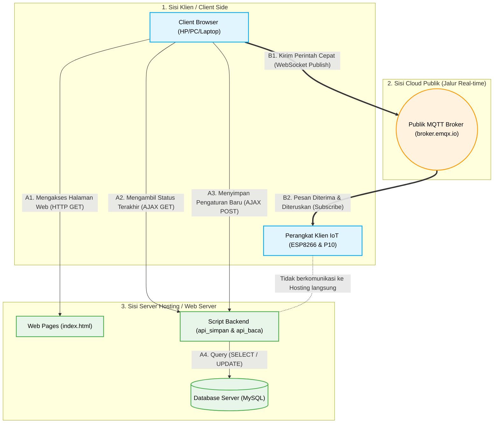

# Arsitektur Jaringan: Klien, Cloud, dan Server Hosting

Diagram ini berfokus pada topologi jaringan (Network Architecture) yang memperlihatkan bagaimana perangkat di sisi klien berkomunikasi hingga ke server hosting dan server MQTT.

### 💡 Analisis Arsitektur:

1. **Client Browser (HP/Laptop) ke Server Hosting:**
   * Klien membuka browser dan meminta halaman `index.html` dari Server Hosting.
   * Saat pertama kali dimuat, browser melakukan proses **AJAX/API Call** ke Server Hosting (`api_baca.php`) untuk melihat data terakhir di Database MySQL.
   * Saat pengguna menekan "Kirim", browser akan melakukan proses **AJAX POST** ke Server Hosting (`api_simpan.php`) untuk memperbarui data MySQL.

2. **Perangkat Alat IoT Klien (ESP8266) Tidak Menghubungi Hosting:**
   * Untuk menghindari Server Hosting dari beban *request* berulang setiap detiknya (yang sering menyebabkan server/hosting down), **Alat IoT tidak pernah meminta data langsung ke PHP/MySQL**.

3. **Peran Jembatan MQTT (Cloud Publik):**
   * Sebagai gantinya, komunikasi dari Browser Klien ke Alat Klien dilewatkan melalui pihak ketiga, yaitu **MQTT Broker (broker.emqx.io)**.
   * Ini memastikan respon pengiriman sangat cepat (*real-time*) dan tidak membebani limit *bandwidth* maupun *resource* dari Server Hosting Anda.
