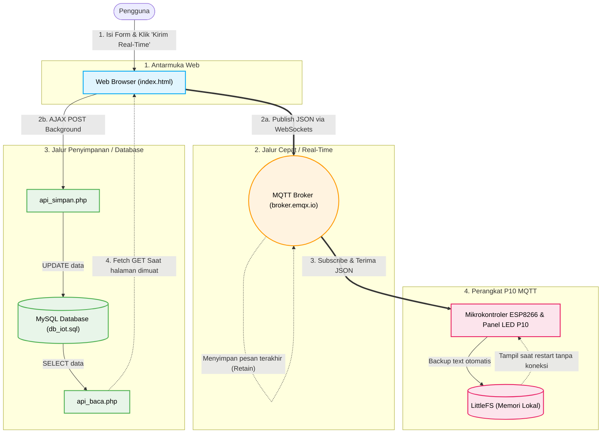

# Visual Mapping Alur Sistem IoT P10 MQTT

Berikut adalah diagram alur kerja dari project IoT P10 MQTT. Diagram ini mengilustrasikan bagaimana 3 komponen utama (Web Frontend, Database/Backend, dan Hardware IoT) saling berinteraksi secara *real-time*.

### 💡 Penjelasan Alur Cara Kerja Sistem:

1. **Input Pengguna:** 
   Pengguna membuka halaman web `index.html`, mengisi pengaturan teks (seperti kecepatan dan kecerahan), lalu menekan tombol **Kirim Real-Time**.
2. **Pengiriman Ganda Secara Bersamaan:** 
   * **(2a) Jalur Cepat IoT:** Web *(Javascript)* langsung mem-publish data ke server MQTT (`broker.emqx.io`) menggunakan protokol WebSocket. Jalur ini sangat responsif dan melesat dalam hitungan milidetik.
   * **(2b) Jalur Penyimpanan Web:** Secara bersamaan dan diam-diam *(menggunakan AJAX)*, web juga mengirimkan data tersebut ke `api_simpan.php` untuk disimpan secara permanen di dalam Database MySQL (`db_iot.sql`).
3. **Penerimaan Real-Time di Hardware:** 
   Hardware NodeMCU ESP8266 yang sudah terkoneksi ke internet terus memantau (*subscribe*) dari Broker MQTT. Begitu data dari jalur cepat (2a) masuk ke MQTT, ESP8266 akan langsung menerimanya dan mengubah tampilan di Panel LED P10 detik itu juga.
4. **Sistem Pemulihan & Backup Data (Agar Data Tidak Hilang):**
   * **Untuk Web:** Ketika pengguna merefresh web atau membukanya keesokan hari, halaman tidak akan kosong. Web akan memanggil `api_baca.php` untuk menarik memori terakhir yang tersimpan di MySQL, sehingga formulir web kembali terisi sesuai dengan pengaturan terakhir alat.
   * **Untuk Hardware IoT:** Pesan MQTT menggunakan fitur *Retain*, yang berarti MQTT secara otomatis mencadangkan pesan terakhir. Selain itu, ESP8266 juga menyimpan pesan di memori lokalnya (*LittleFS*). Jika panel LED mati listrik dan menyala kembali, ia dapat menampilkan teks terakhirnya, bahkan ketika internet sedang putus sekalipun.
